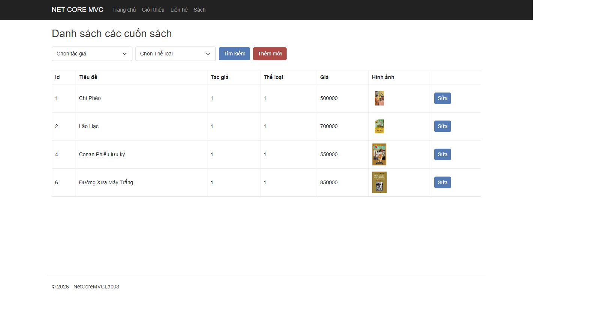
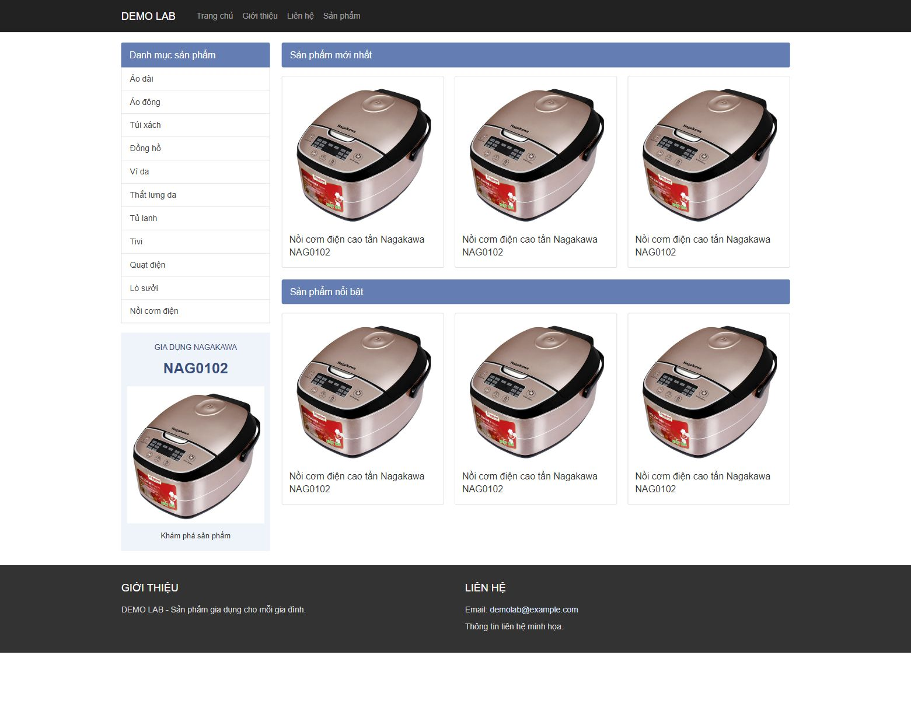

# Lab 03 - ASP.NET Core MVC: View

Bài thực hành theo tài liệu **Labguide03-AspNetCore-View.pdf** (20 trang, 5 bài hướng dẫn và bài tập tự làm sản phẩm).

[Tài liệu được giao](https://drive.google.com/file/d/1FZjBGzHFIpCxvzC-3lgQTJV1cLSNtIPU/view)

## Hai project trong cùng solution

| Project | Nội dung | Địa chỉ khi chạy |
| --- | --- | --- |
| `src/NetCoreMVCLab03` | Danh sách sách, form thêm/sửa, tìm kiếm, Banner Partial View, AJAX và Book View Component | http://localhost:5003 |
| `src/NetCoreMVCLab03.Products` | Bài tự làm trang sản phẩm: danh mục Partial View, sản phẩm mới từ action, HotProduct View Component | http://localhost:5103 |
| `tests/NetCoreMVCLab03.Tests` | Kiểm thử tích hợp HTTP, dữ liệu, form và ảnh | `dotnet test` |

Không cần SQL Server, tài khoản đăng nhập hoặc dịch vụ bên ngoài để chạy bài.

## Chạy bằng Visual Studio

1. Cài workload **ASP.NET and web development** và **.NET 8 SDK**.
2. Giải nén toàn bộ bài vào một thư mục; mở `NetCoreMVCLab03.sln`.
3. Trong Solution Explorer, bấm phải project **NetCoreMVCLab03** rồi chọn **Set as Startup Project**.
4. Chọn profile **http**, bấm **Ctrl+F5**. Nếu trình duyệt chưa mở, truy cập `http://localhost:5003`.
5. Để xem bài sản phẩm, đặt **NetCoreMVCLab03.Products** làm Startup Project, chọn **http** và chạy. Địa chỉ: `http://localhost:5103`.

Có thể đặt cả hai project là **Start** trong cấu hình Multiple startup projects của solution. Không chọn project Tests làm Startup Project.

## Chạy bằng Terminal

Mở Terminal tại thư mục chứa file `.sln`:

```powershell
dotnet restore NetCoreMVCLab03.sln
dotnet build NetCoreMVCLab03.sln
dotnet test NetCoreMVCLab03.sln
dotnet run --project src/NetCoreMVCLab03 --launch-profile http
```

Mở Terminal thứ hai để chạy bài tự làm:

```powershell
dotnet run --project src/NetCoreMVCLab03.Products --launch-profile http
```

Dừng server bằng **Ctrl+C**. Nếu cổng đang được một ứng dụng khác sử dụng, chọn cổng khác, ví dụ:

```powershell
dotnet run --project src/NetCoreMVCLab03 --no-launch-profile --urls http://localhost:5004
```

## Xem và thử chức năng

- Trang chủ sách: xem carousel, chuyển banner bằng mũi tên; bấm **Tải sách phổ biến** để tải Partial View qua AJAX. Danh sách **Sách nổi bật** phía dưới được render bằng `BookViewComponent`.
- `/Book`: danh sách 4 bản ghi mẫu, lọc theo tác giả và thể loại. Hai điều kiện được kết hợp bằng AND; để trống bộ lọc sẽ hiện tất cả.
- `/Book/Create`: điền tên, tác giả, thể loại, giá, số trang, chọn ảnh rồi bấm **Lưu lại**. Giá nhập bằng số, không kèm dấu phân cách hàng nghìn; dấu chấm dùng cho phần thập phân.
- Bấm **Sửa** tại từng dòng. Form nạp dữ liệu hiện tại; không chọn ảnh mới thì giữ ảnh cũ.
- Ảnh hỗ trợ JPG/JPEG, PNG, WebP, tối đa 5 MB; có xem trước và kiểm tra đuôi/chữ ký đầu file ở server. Đây là kiểm tra định dạng cơ bản, không thay thế bộ quét mã độc hoặc bộ giải mã ảnh đầy đủ.
- Trang sản phẩm có hai hàng 3 sản phẩm giống dữ liệu minh họa trong đề. Danh mục bên trái dẫn tới bộ lọc; danh mục chưa có sản phẩm hiển thị trạng thái trống. Bấm sản phẩm để xem chi tiết.

## Dữ liệu

`Models/Book.cs` giữ các thuộc tính và hai hàm mẫu `GetBookList()`, `GetBookById(int id)` theo tài liệu, bao gồm tên thuộc tính `Sumary`.

`BookCatalog` lấy 4 bản ghi mẫu ở lần chạy đầu. Sau khi thêm/sửa, dữ liệu được lưu vào `src/NetCoreMVCLab03/App_Data/books.json`; ảnh mới nằm trong `wwwroot/images/products/uploads`. Đọc danh sách qua catalog sẽ thấy cả các thay đổi đã lưu, kể cả sau khi khởi động lại server.

Các thư mục dữ liệu phát sinh không đưa vào Git hoặc ZIP bài nộp. Để quay lại dữ liệu mẫu, dừng ứng dụng và **đổi tên để sao lưu** `App_Data/books.json`; chạy lại sẽ nạp 4 sách mẫu. Cấu hình `DataDirectory` cho phép đặt dữ liệu tại thư mục khác khi kiểm thử.

Các mã tác giả/thể loại, giá và tên mẫu được giữ theo bài thực hành, không phải thông tin thư mục sách hoặc giá bán thực tế. `TotalPage` ở những dòng không đọc được đầy đủ trong ảnh đề dùng số minh họa. Những ảnh bìa này là ảnh thay thế, không cam kết cùng ấn bản với ảnh trong PDF.

## Các điều chỉnh so với tài liệu

- Tài liệu sử dụng ASP.NET Core 2.1; bài này dùng **.NET 8** với `Program.cs` thay cho `Startup.cs` để chạy trên SDK đang cài trên máy.
- Dùng Bootstrap 5 cục bộ thay cho Bootstrap 3, kèm CSS mô phỏng bố cục mẫu và bổ sung hỗ trợ màn hình nhỏ.
- `AuthorId` giữ kiểu `string`, nên giá trị khởi tạo được viết là `"1"`, sửa lỗi khác kiểu trong đoạn code minh họa.
- Partial View danh sách sách đặt trong `Views/Book/PopularBook.cshtml` để đúng controller; không đặt nhầm trong `Views/Product`.
- Bổ sung POST thêm/sửa, lưu JSON, kiểm tra dữ liệu, upload ảnh và tìm kiếm hoạt động. Đề minh họa chủ yếu phần GET/View.
- Bài sản phẩm có thêm danh mục **Nồi cơm điện** để lọc đúng sản phẩm mẫu, và trang chi tiết để các liên kết hoạt động.
- Ảnh quảng bá bên trái dùng sản phẩm Nagakawa thay cho banner khuyến mại không có file gốc trong đề. Không sao chép số tiền khuyến mại hoặc thông tin liên hệ không được cung cấp.
- Không bổ sung đăng nhập, giỏ hàng, thanh toán, xóa sách hoặc cơ sở dữ liệu SQL vì không thuộc yêu cầu Lab 03.

Xem [đối chiếu yêu cầu và kiểm tra thủ công](docs/DOI_CHIEU_YEU_CAU.md), [nguồn hình ảnh](docs/NGUON_HINH_ANH.md).

## Ảnh chụp ứng dụng





## Lưu ý khi nộp

Nộp toàn bộ source trong ZIP hoặc link repository chứa file `.sln`, `src`, `tests`, tài liệu và ảnh. Không chỉ nộp file `.exe`, `bin` hoặc `.csproj` riêng lẻ. Workflow GitHub Actions đã chuẩn bị sẵn tại `.github/workflows/dotnet.yml`; nó sẽ build và test sau khi đẩy source lên GitHub.

Đây là ứng dụng thực hành chạy cục bộ, chưa có xác thực/phân quyền và không dành để mở chức năng quản lý công khai trên Internet.
